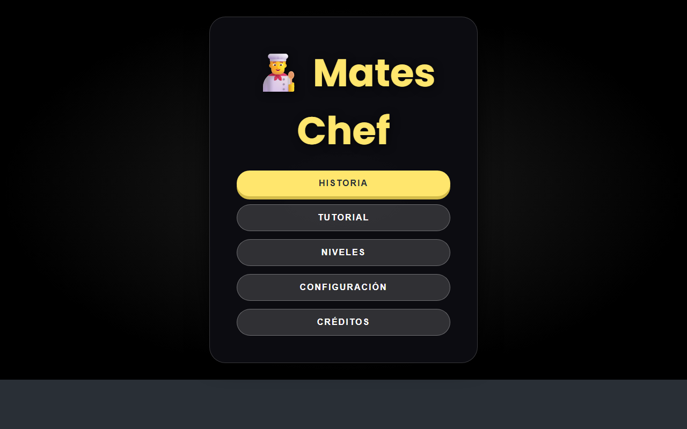
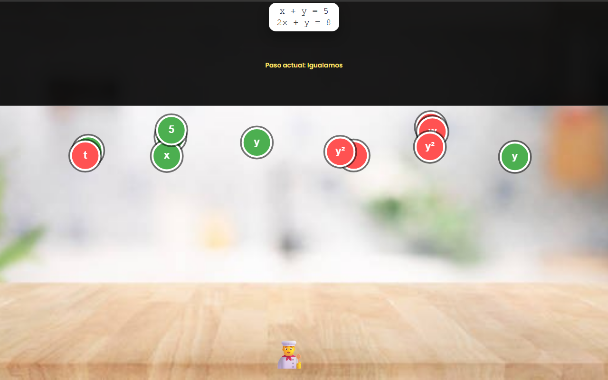

# 👨‍🍳 Mates Chef (Chef-Game)


**Mates Chef** es un juego web educativo de álgebra: eres un chef que debe atrapar ingredientes para preparar el plato perfecto... ¡pero cada receta es un **sistema de ecuaciones 2x2** que hay que resolver paso a paso!

> 📖 **Historia**: Acompaña a un padre chef que, con la ayuda de sus dos hijos, debe preparar el plato perfecto para su profesor favorito. Cada ingrediente es un problema de álgebra: resuélvelo a tiempo y conquista el paladar del profesor.

---

## 🎮 Cómo jugar

1. Abre `index.html` con doble clic (no necesita servidor ni instalación)
2. Atrapa las **bolitas verdes** ✔️ con el orden correcto para ir construyendo la solución de cada paso
3. **Evita las bolitas rojas** ❌ y no dejes que los ingredientes correctos se te caigan
4. Completa los 4 pasos de cada nivel: **Igualamos → Sustituimos → Resolvemos → Verificamos**

### Controles

| Acción | Control |
|---|---|
| Mover al chef | 🖱️ Ratón / táctil o `↑ ↓ ← →` / `W A S D` |
| Pausar | `Esc` o botón ⏸️ |
| Configuración | Volumen de música, efectos y otros |

Tienes **3 vidas** ❤️: si un ingrediente verde cae al suelo pierdes una. Al completar un nivel recibes de 1 a 3 ⭐ según el tiempo restante.

---

## ✨ Características

- 🧮 **8 niveles** de sistemas de ecuaciones con dificultad progresiva
- 🎚️ **Modos Fácil / Medio / Difícil** que modifican la velocidad de caída y la frecuencia de ingredientes
- 🖥️ **Jugable con doble clic** — sin dependencias ni servidor (JS clásico)
- ♿ Historia, tutorial interactivo y sonidos
- 🎬 **Cinemáticas finales de victoria y de derrota**
- 🏆 Puntuación con bonus por tiempo y estrellas por nivel
- 🎨 Programado 100% con **Programación Orientada a Objetos**

---

## 📸 Capturas

| Menú principal | Pantalla de juego |
|---|---|
|  |  |

---

## 📁 Estructura del proyecto

```
Chef-Game/
├── index.html          # Punto de entrada
├── LICENSE             # Licencia MIT
├── js/
│   ├── main.js                 # Arranque
│   ├── AlgebraChef.js          # Controlador principal + clase Chef
│   ├── AlgebraChef_GameLogic.js# Lógica de niveles y recolección
│   ├── ExpressionProgress.js   # Progreso de la ecuación
│   ├── FallingObject.js        # Ingredientes que caen
│   ├── GameRenderer.js         # Dibujo en canvas
│   ├── UIManager.js            # Pantallas y UI
│   ├── SoundManager.js         # Música y efectos
│   ├── TutorialManager.js      # Tutorial interactivo
│   ├── levels.js               # Definición de los 8 niveles
│   └── utils.js                # Utilidades compartidas
├── css/                # Estilos del juego
├── assets/             # Audio, imagen de fondo y pantallas de final
└── docs/               # Capturas para el README
```

---

## 🔧 Tecnologías

- **HTML5 + CSS3** (responsive, móvil y escritorio)
- **JavaScript clásico** con clases (POO)
- **Canvas API** para el gameplay
- **Audio/Video nativo** del navegador

---

## 👥 Proyecto escolar

Proyecto escolar de programación desarrollado en equipo por estudiantes del nivel secundario, con la orientación del profesor de la asignatura.

Los créditos dentro del juego presentan al equipo y sus roles.

---

## 📄 Licencia

Publicado bajo la licencia [MIT](LICENSE): puedes usar, estudiar, modificar y compartir este proyecto, dando crédito a sus autores.

---

*¡Prepara el plato perfecto y demuestra tu talento con las mates!* 🍳✨
